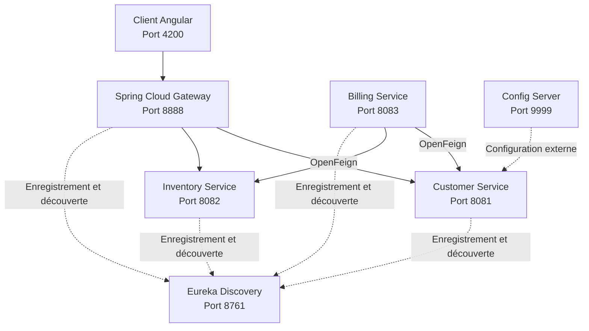

# E-Commerce Microservices Architecture with Spring Cloud

**Activité Pratique N°2 — Architecture Microservices avec Spring Cloud**

| Information | Détail |
|---|---|
| Étudiante | Imane Mekkaoui |
| Formation | Master SDIA |
| Backend | Java, Spring Boot, Spring Cloud |
| Frontend | Angular 19 |
| Architecture | Microservices distribués |

---

## Sommaire

- [1. Présentation du projet](#-1-présentation-du-projet)
- [2. Objectifs pédagogiques](#-2-objectifs-pédagogiques)
- [3. Architecture du système](#-3-architecture-du-système)
- [4. Description des composants](#-4-description-des-composants)
- [5. Technologies utilisées](#-5-technologies-utilisées)
- [6. Structure du projet](#-6-structure-du-projet)
- [7. Prérequis](#-7-prérequis)
- [8. Installation et démarrage](#-8-installation-et-démarrage)
- [9. Tests et validation](#-9-tests-et-validation)
- [10. Captures d'écran](#-10-captures-décran)
- [11. Configuration et bonnes pratiques](#-11-configuration-et-bonnes-pratiques)
- [12. Ressources pédagogiques](#-12-ressources-pédagogiques)

---

## 1. Présentation du projet

Ce projet consiste à concevoir et à développer une application e-commerce reposant sur une **architecture microservices** avec Spring Boot et Spring Cloud.

L'application permet de gérer les clients, les produits et les factures. Chaque domaine métier est isolé dans un service indépendant, tandis que les composants Spring Cloud assurent la découverte des services, le routage des requêtes et la centralisation de la configuration.

Un client web développé avec Angular permet d'interagir avec les API de l'application.

Le projet met en pratique les principaux mécanismes d'un système distribué : communication REST, API Gateway, découverte de services, configuration centralisée et communication interservices avec OpenFeign.

## 2. Objectifs pédagogiques

Les objectifs de cette activité pratique sont les suivants :

- Concevoir une architecture basée sur des microservices indépendants.
- Développer des API REST avec Spring Boot.
- Créer une passerelle avec Spring Cloud Gateway.
- Configurer le routage des requêtes HTTP.
- Enregistrer et découvrir les services avec Eureka.
- Communiquer entre microservices à l'aide d'OpenFeign.
- Centraliser la configuration avec Spring Cloud Config Server.
- Développer un client web avec Angular.
- Tester l'intégration des composants et les échanges entre services.

## 3. Architecture du système

L'application est composée de six services Spring Boot et d'un client Angular.



### Fonctionnement général

1. L'utilisateur accède à l'application Angular.
2. Le frontend envoie les requêtes HTTP vers la Gateway.
3. La Gateway route les requêtes vers les services concernés.
4. Eureka assure l'enregistrement et la découverte des services.
5. Billing Service utilise OpenFeign pour récupérer les informations des clients et des produits nécessaires à une facture.
6. Config Server fournit les propriétés externalisées aux services configurés pour l'utiliser.

> **Remarque :** les routes explicites de la Gateway utilisent les noms des services avec le préfixe `lb://`. La découverte automatique de routes à partir d'Eureka est une fonctionnalité distincte et doit être activée et vérifiée séparément si elle est exigée.

## 4. Description des composants

### 4.1 Customer Service

**Port : `8081`**

Ce service est responsable de la gestion des clients.

Fonctionnalités :
- Consulter la liste des clients.
- Consulter un client par son identifiant.
- Exposer les données clients aux autres services.

Endpoints testés :

| Méthode | Endpoint | Résultat |
|---|---|---|
| GET | `/customers` | Liste des clients |
| GET | `/customers/{id}` | Détails d'un client |

### 4.2 Inventory Service

**Port : `8082`**

Ce service gère le catalogue des produits.

Fonctionnalités :
- Consulter la liste des produits.
- Consulter un produit par son identifiant.
- Fournir les informations produits au service de facturation.

Endpoints testés :

| Méthode | Endpoint | Résultat |
|---|---|---|
| GET | `/products` | Liste des produits |
| GET | `/products/{id}` | Détails d'un produit |

### 4.3 Billing Service

**Port : `8083`**

Ce service gère les factures et leur contenu.

Responsabilités :
- Consulter les factures.
- Associer une facture à un client.
- Associer les produits et les quantités à une facture.
- Récupérer les données externes via OpenFeign.
- Retourner une facture enrichie avec les informations du client et des produits.

Endpoints testés :

| Méthode | Endpoint | Description |
|---|---|---|
| GET | `/bills` | Liste des factures |
| GET | `/bills/{id}` | Détails d'une facture enrichie |
| POST | `/bills/full` | Création d'une facture complète |

### 4.4 Discovery Service — Eureka

**Port : `8761`**

Eureka fournit un annuaire des microservices.

Il permet :
- L'enregistrement des instances.
- La découverte des services par leur nom.
- La disponibilité des informations sur les instances enregistrées.

Interface :

`http://localhost:8761`

### 4.5 Gateway Service — Spring Cloud Gateway

**Port : `8888`**

La Gateway constitue le point d'entrée HTTP pour les routes configurées.

Routes configurées :

| Route | Destination |
|---|---|
| `/customers/**` | `lb://CUSTOMER-SERVICE` |
| `/products/**` | `lb://INVENTORY-SERVICE` |

Le préfixe `lb://` permet à la Gateway de résoudre la destination via le mécanisme de découverte et de répartition de charge configuré dans Spring Cloud.

### 4.6 Config Service — Spring Cloud Config Server

**Port : `9999`**

Ce service centralise les propriétés externalisées dans un dépôt Git.

Il permet de partager des paramètres communs et spécifiques à chaque application, par exemple :

```properties
global.params.p1=100
global.params.p2=200
customer.params.x=10
customer.params.y=20
```

Les services clients doivent être configurés pour importer les propriétés depuis Config Server.

### 4.7 Client Angular

**Dossier :** `ecom-client-ang`

Le frontend Angular fournit l'interface utilisateur.

Éléments principaux :
- Navigation entre les pages Customers et Products.
- Services Angular dédiés aux appels HTTP.
- Communication avec la Gateway sur le port `8888`.
- Utilisation de Bootstrap pour la présentation.

## 5. Technologies utilisées

| Technologie | Rôle |
|---|---|
| Java | Langage backend |
| Spring Boot | Développement des services |
| Spring Cloud Gateway | Routage HTTP |
| Spring Cloud Netflix Eureka | Découverte des services |
| Spring Cloud Config | Configuration centralisée |
| OpenFeign | Appels REST interservices |
| Resilience4j | Gestion de la résilience des appels configurés |
| REST / HTTP | Communication entre composants |
| Angular 19 | Interface web |
| Bootstrap 5 | Mise en forme de l'interface |
| Maven | Construction et gestion des dépendances backend |
| npm | Gestion des dépendances frontend |
| Git et GitHub | Gestion de versions |

## 📁 6. Structure du projet

```text
architecture-microservices-spring-cloud/
│
├── customer-service/
│   └── src/
├── inventory-service/
│   └── src/
├── billing-service/
│   └── src/
├── gateway-service/
│   └── src/
├── discovery-service/
│   └── src/
├── config-service/
│   └── src/
├── ecom-client-ang/
│   ├── src/
│   ├── angular.json
│   ├── package.json
│   └── package-lock.json
├── customer-service.properties
├── pom.xml
├── .gitignore
├── docs/
│   └── screenshots/
└── README.md
```

Cette arborescence présente les principaux composants du dépôt. Les fichiers et sous-dossiers exacts peuvent varier selon l'organisation du code.

## 7. Prérequis

Avant de démarrer le projet, installer :

- JDK compatible avec la configuration Maven du projet.
- Maven, ou le Maven Wrapper si disponible.
- Node.js et npm.
- Git.
- Un IDE comme IntelliJ IDEA ou Visual Studio Code.

Vérifier les installations :

```bash
java -version
mvn -version
node -v
npm -v
git --version
```

## 8. Installation et démarrage

### 8.1 Cloner le dépôt

```bash
git clone https://github.com/ImaneMekkaoui1/architecture-microservices-spring-cloud.git
cd architecture-microservices-spring-cloud
```

### 8.2 Compiler le backend

Depuis la racine du projet :

```bash
mvn clean package -DskipTests
```

Cette commande compile le projet sans exécuter les tests automatisés.

### 8.3 Démarrer les services backend

Lancer chaque service dans un terminal distinct. L'ordre recommandé, à adapter aux dépendances de configuration, est :

1. Config Service — `9999`
2. Discovery Service — `8761`
3. Customer Service — `8081`
4. Inventory Service — `8082`
5. Billing Service — `8083`
6. Gateway Service — `8888`

Exemple de démarrage d'Eureka :

```bash
cd discovery-service
mvn spring-boot:run
```

Pour les autres services, utiliser la même commande depuis le dossier correspondant.

Vérifier que les services démarrent sans erreur et apparaissent dans le tableau de bord Eureka.

### 8.4 Démarrer le frontend Angular

Dans un nouveau terminal :

```bash
cd ecom-client-ang
npm install
npm start
```

Ouvrir ensuite :

`http://localhost:4200`

Les six services backend doivent être démarrés pour tester l'ensemble de l'application.

## 9. Tests et validation

Les tests ci-dessous correspondent aux vérifications effectuées pendant le développement.

### 9.1 Vérifier Eureka

Ouvrir :

`http://localhost:8761`

Les services suivants ont été observés avec le statut `UP` :

- `BILLING-SERVICE`
- `CONFIG-SERVICE`
- `CUSTOMER-SERVICE`
- `GATEWAY-SERVICE`
- `INVENTORY-SERVICE`

### 9.2 Tester les clients

```bash
curl -i http://localhost:8081/customers
```

Résultat observé : réponse HTTP `200 OK` avec une liste de trois clients.

### 9.3 Tester les produits

```bash
curl -i http://localhost:8082/products
```

Résultat observé : réponse HTTP `200 OK` avec quatre produits.

### 9.4 Tester les routes de la Gateway

```bash
curl -i http://localhost:8888/customers
curl -i http://localhost:8888/products
```

Résultat observé : les deux routes retournent les données des services correspondants.

### 9.5 Tester la configuration centralisée

```bash
curl -i http://localhost:8081/testConfig1
curl -i http://localhost:8081/testConfig2
```

Résultats observés :

- `/testConfig1` retourne les paramètres `p1=100` et `p2=200`.
- `/testConfig2` retourne les paramètres `x=10` et `y=20`.

### 9.6 Tester Billing Service et OpenFeign

Liste des factures :

```bash
curl -i http://localhost:8083/bills
```

Détails d'une facture :

```bash
curl -i http://localhost:8083/bills/1
```

Résultat observé : réponse HTTP `200 OK`. La facture `1` contient les informations du client Mohamed et les détails des produits Computer, Printer et Smartphone.

Ce test confirme que Billing Service récupère les informations du client et des produits via ses clients OpenFeign lorsque les services concernés sont disponibles.

### 9.7 Tester Angular

Ouvrir `http://localhost:4200`, puis vérifier :

- L'affichage de l'application.
- La navigation vers Customers.
- La navigation vers Products.
- Le chargement des données depuis le backend.

Les opérations de création, modification et suppression doivent être testées séparément avant d'être déclarées validées.

## 10. Captures d'écran

### 10.1 Tableau de bord Eureka

*Objectif : démontrer l'enregistrement des cinq services backend.*


### 10.2 Liste des clients — Customer Service

*Objectif : illustrer le résultat de l'appel `GET /customers`.*


### 10.3 Liste des produits — Inventory Service

*Objectif : illustrer le résultat de l'appel `GET /products`.*


### 10.4 Routage via Spring Cloud Gateway

*Objectif : montrer les réponses obtenues via le port `8888`.*


### 10.5 Configuration centralisée

*Objectif : illustrer les paramètres récupérés depuis Config Server.*


### 10.6 Facture enrichie — Billing Service et OpenFeign

*Objectif : montrer une facture contenant les informations du client et des produits.*


### 10.7 Interface Angular — Customers

*Objectif : présenter l'affichage des clients dans le frontend.*


### 10.8 Interface Angular — Products

*Objectif : présenter l'affichage des produits dans le frontend.*


## 11. Configuration et bonnes pratiques

- Ne pas versionner de mots de passe, clés API ou autres secrets.
- Vérifier les ports et les URL de chaque service.
- Garder les responsabilités métier séparées entre les microservices.
- Centraliser les paramètres communs lorsque cela est pertinent.
- Vérifier les statuts Eureka avant de tester les communications interservices.
- Tester les API indépendamment avant les tests d'intégration.
- Documenter les erreurs et les corrections apportées.
- Conserver les captures d'écran des tests comme preuves de validation.

## 12. Ressources pédagogiques

### Architecture microservices avec Spring Cloud

- [Partie 1 — Architecture microservices](https://www.youtube.com/watch?v=kOVHzN8I8e8)
- [Partie 2 — Architecture microservices](https://www.youtube.com/watch?v=-iM3J_mgqlM)

### Spring Cloud Config Server

- [Vidéo — Spring Cloud Config](https://www.youtube.com/watch?v=-G2rcLMO1gQ)


---

Conclusion

Cette activité pratique met en œuvre une architecture microservices fondée sur Spring Boot et Spring Cloud. Elle couvre la séparation des services métier, le routage HTTP, la découverte des services, la communication interservices avec OpenFeign, la configuration centralisée et l'intégration d'un client Angular.

Les tests réalisés confirment le démarrage des services, le fonctionnement des routes principales, la récupération de la configuration distante et l'enrichissement d'une facture avec les informations du client et des produits.

Les fonctionnalités supplémentaires, notamment le routage automatique par découverte et les opérations CRUD non encore vérifiées, doivent être validées selon les exigences exactes de l'activité.

*Projet réalisé dans le cadre de l'Activité Pratique N°2 — Architecture Microservices avec Spring Cloud.*
